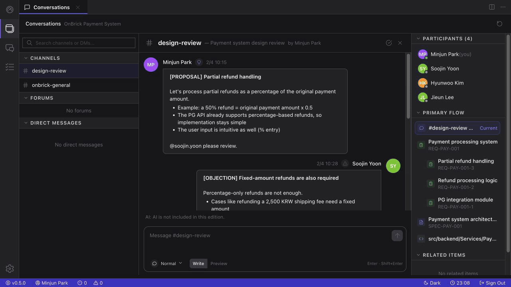
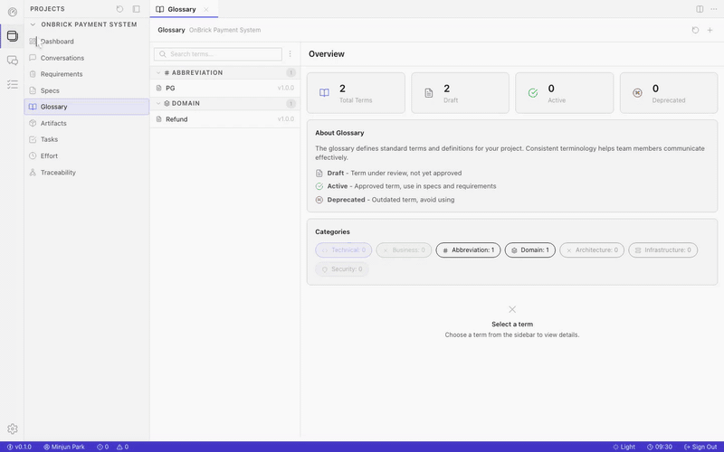

# SDDP — Spec-Driven Design Platform

> People decide, specs remember, code proves.

SDDP turns discussions and agreements into structured specs and keeps implementation changes traceable against those specs.

Code explains what changed. SDDP keeps the why.

This public repository contains the application runtime, public tests, and the OnBrick showcase assets needed to evaluate the product.

## One Decision, End to End

A partial-refund decision moves from the design discussion into an explicit requirement, a reviewed spec, and the implementation artifact that proves it.



## Why SDDP?

If you open code written six months ago and can no longer explain why it looks that way, SDDP is the problem space we care about.

- Preserve decision context through **Conversation -> Requirement -> Spec -> Code**
- Treat approved specs as locked and evolve them through versioned updates
- Detect implementation drift when code moves away from the approved spec
- Dictate conversation messages with local speech-to-text (Whisper, no cloud calls)

Public setup and evaluation notes are in [docs/public-guide.md](docs/public-guide.md).

## Explore the Whole Project Context

Move through the vocabulary, implementation artifacts, work, and effort behind a project, then inspect the Traceability graph that connects a spec back to its requirement and code.



## Tech Stack

| Layer | Technology |
|-------|-----------|
| Frontend | Svelte 5, TypeScript, TailwindCSS, Vite |
| Backend | .NET 10, C#, ASP.NET Core |
| Database | PostgreSQL (EF Core + Dapper) |
| Cache | Redis |
| Observability | Aspire Dashboard, Serilog |

## Quick Start

### Prerequisites

- Docker
- Node.js 22 LTS recommended
- .NET 10 SDK

### Docker-Only Setup

```bash
git clone https://github.com/yang-gyunam/sddp.git sddp
cd sddp
cp src/frontend/packages/web/.env.example src/frontend/packages/web/.env

docker compose up -d sddp-db sddp-redis sddp-aspire
make db-provision      # clean DB only; use 'make db-reset' to re-provision
make db-seed-test
docker compose up -d sddp-api sddp-front
```

Host-side `npm install` is not required when you use the frontend container only.

Optional — speech-to-text for conversation messages (local Whisper):

```bash
docker compose up -d sddp-whisper
make whisper-warmup    # one-time model download (~460MB)
```

### Local Frontend Development (Optional)

Use this path only if you want Vite HMR or local frontend test commands.

```bash
cp src/frontend/packages/web/.env.example src/frontend/packages/web/.env

make infra
docker compose up -d sddp-api
cd src/frontend
npm install
cd packages/web
npm run dev
```

### Service URLs

| Service | URL |
|---------|-----|
| Frontend (Docker) | http://localhost:9010 |
| Frontend (Vite dev) | http://localhost:3500 |
| API | http://localhost:5001 |
| API Docs (Scalar) | http://localhost:5001/scalar/v1 |
| Aspire Dashboard | http://localhost:18888 |
| Whisper STT (optional) | http://localhost:9020 |

## Project Structure

```text
src/
├── backend/
│   ├── Sddp.Api/
│   ├── Sddp.Application/
│   ├── Sddp.Domain/
│   ├── Sddp.Infrastructure/
│   └── Sddp.Abstractions/
└── frontend/packages/
    ├── ui/
    ├── shell/
    ├── activities/
    └── web/
```

## Documentation

- [Public Guide](docs/public-guide.md) — supported setup, database, testing, and repository scope
- [scripts/db/README.md](scripts/db/README.md) — SQL provisioning entry points
- [src/frontend/packages/web/README.md](src/frontend/packages/web/README.md) — web package commands

## Testing

```bash
make test
make lint

cd src/frontend
npm run test:e2e
```

In the public repository, `npm run test:e2e` runs the OnBrick showcase path only.

## Contributing

Issues and pull requests are reviewed on a best-effort basis.

## License

[Apache-2.0](LICENSE)
